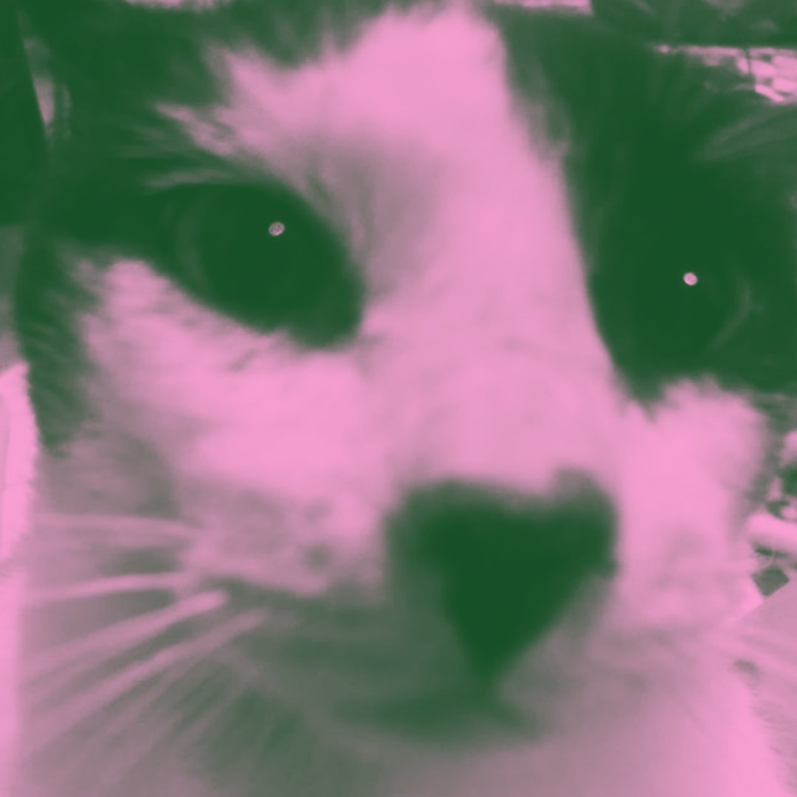

<div align="center">
  <h1>kuenobaikbanget — Portfolio</h1>
  
</div>

---

## Overview

Personal portfolio for **Akbar Dwi Maulana** ([kueno.web.id](https://kueno.web.id/)) — 3rd-year Information Systems student at UPN "Veteran" Jakarta focusing on IoT, embedded hardware, Linux systems, networking, and practical software.

- **Hero & Tuxedo Desk Companion:** Recruiter-ready summary, interactive email action popover, and a sleepy tuxedo cat widget.
- **Featured Projects:** `opspilot`, `FinNote`, and `Aero FIK Project — KSM Robotika`.
- **Experience & Education:** Internships at PT Kalapa Technology Putera & PT Datasoft Informatika Technologi, plus UPNVJ academic record.
- **Tech Toolbox:** Filterable tactile keycap matrix across IoT & Hardware, Linux & Networking, Dev (Web & Mobile), and Security & Tools.
- **Off-Duty Bench:** Compact WebP gallery for mechanical keyboards, mice, Hario Switch pour-over coffee, and cassettes.

## Development

```bash
npm install
npm run dev
npm run lint
npm run build
```
